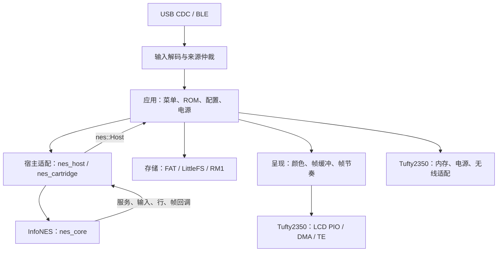

# 固件架构

固件由模拟核心、宿主适配、呈现、硬件平台和应用五部分组成。目标硬件为 Tufty2350；核心与卡带接口不依赖 Pico SDK，可在主机上独立编译和测试。

## 模块关系



核心执行 CPU、PPU、APU 和 Mapper；宿主通过同步回调提供输入、输出和服务。应用负责选择游戏及组织设备行为，核心不访问文件系统、无线、菜单或硬件寄存器。

## 目录与构建目标

```text
.
├── infones/              CPU、PPU、APU、区域与 Mapper 实现
├── core_api/             卡带元数据与宿主回调接口
├── adapters/infones/     卡带加载及 InfoNES 宿主桥接
├── presentation/        帧发布、颜色转换与帧时钟
├── platform/tufty2350/   LCD、内存、电源和无线平台适配
├── app/                  菜单、输入、USB、BLE、存储和电源策略
├── board/                Tufty2350 板级定义
├── config/               USB、BTstack 等编译配置
├── cmake/                设备工具链接入、固件目标及链接边界
├── patch/                固定外部依赖所需的补丁
├── tools/                构建、依赖准备、打包与 PC 工具
├── tests/                核心、呈现和业务主机测试
├── docs/                 使用与开发文档
├── licenses/             随源码和资源保留的许可证
└── roms/                 用户本地游戏与素材，不随项目分发
```

| 目标 / 目录 | 职责与边界 |
|---|---|
| `nes_core` / `infones` | 模拟机器；通过 `InfoNES_System.h` 和 `InfoNES_Port.h` 请求宿主服务 |
| `nes_cartridge` / `core_api`, `adapters/infones` | 格式检查、板型约束、初始化和卸载，无 Pico 依赖 |
| `nes_host` / `adapters/infones` | 将 InfoNES 回调桥接为 `nes::Host`，管理一次同步运行 |
| `presentation` | NES 行颜色编码、完整帧发布、显示所有权和逻辑帧节奏 |
| `platform/tufty2350` | LCD 传输、内存分配、电源硬件、ADC 电量测量和无线 SDK 适配 |
| `nes` / `app` | 组合上述模块，构建 `tufty-nes-flash` 设备固件 |

外部库提供 SDK、无线协议栈、文件系统和 JSON，版本由 `deps.lock.json` 固定，准备方式见[构建指南](building.md#依赖管理)。

## 执行模型与资源所有权

| 执行位置 | 拥有的状态 | 主要工作 |
|---|---|---|
| core0 | 模拟器、输入、无线、菜单、配置及文件访问状态 | 执行游戏或菜单，轮询 USB / BLE，组织存储和电源操作 |
| core1 | LCD 传输状态及列缓冲 | 消费已发布的帧，等待 TE，通过 PIO / DMA 输出 |

应用调用 `nes::infones_adapter::run()` 同步运行游戏，返回后恢复菜单。`nes::Host` 的服务、输入、行、帧和日志回调均运行在模拟线程，不可重入核心。接口与借用期限见[核心契约](core-contract.md)。

核心每扫描线调用服务入口；应用将 USB / BLE 轮询节流到约 1 ms 的调用间隔。等待帧期限、菜单显示等路径也继续调用服务。1 ms 是节流目标，不是最坏延迟保证；`nes stats` 记录实际间隔。

ROM 由应用加载到 PSRAM，核心借用其中的 PRG / CHR 数据直到运行结束。加载器复制头信息、清空 SRAM、导入 Trainer，再初始化 Mapper。小于 32 KiB 的分配优先使用内部 SRAM；较大分配或内部 SRAM 分配失败时使用 512 KiB PSRAM arena。最终分配失败会终止运行并向菜单报告错误。分配器只由模拟线程使用，不支持跨核调用。

## 游戏与显示数据流

1. 核心产生 256 像素扫描线，宿主回调接收六位色号及 PPU 遮罩寄存器值。
2. 应用将每行编码为九位颜色 token：六位色号和三位强调。每像素以一字节保存色号，每行另存公共强调位；灰度在编码时处理，透明标志不进入显示颜色。工作帧位于内部 SRAM，像素按列连续排列。
3. 模拟线程直接写入自己持有的 SRAM 帧，完成后通过原子交换发布并取得下一份可写帧，不复制整帧。尚未消费的旧帧可被最新完整帧替换，CPU / PPU / APU 继续执行。
4. 显示核先等待 TE，再取得最新完整帧，将 token 查表转换为 RGB565，以列为单位通过 LCD 驱动发送；游戏画面以 256×240 居中显示在 320×240 屏幕上。
5. DMA 与 PIO 全部排空后，显示核才能在下一次交换中交还自己持有的帧；生产者不能覆盖传输中的内容。

三份游戏帧位于内部 SRAM：生产者、待消费邮箱和消费者各持有一份，通过 acquire / release 原子交换转移所有权。每份像素数据占 60 KiB 色号加 480 字节强调位，按列连续读取。显示核忙时生产者仍能继续，等待 TE 时也允许替换尚未消费的旧帧，避免队列积压。游戏序号与缓冲下标分离。两份菜单缓冲保存在 PSRAM，UI 请求使用独立完成序号；返回菜单时丢弃未消费的游戏帧。

显示核先将行强调位复制到自己的小型 SRAM 数组，再逐列查表。两份 240 像素列缓冲位于内部 SRAM，转换下一列时可传输上一列。显示核不访问模拟器或输入状态；生产者只修改自己持有的帧。

强调色使用 RGB 通道衰减近似，不模拟电视复合视频解码。帧内调色变化以扫描线粒度保存，精度受扫描线核心限制。

### LCD 传输

LCD 驱动使用 PIO1、GPIO base 16、数据 GPIO32–39。DMA 完成后还须等待 PIO TXSTALL，才能切换 DC / CS、复用最后的列缓冲或响应暂停。

启用同步时，每次传输等待 GPIO21 的下一次完整 TE 边沿；TE 持续高或低超过 50 ms 后关闭同步，继续无 TE 输出，并记录超时次数。TE 状态不改变模拟时钟。等待发生在取得游戏帧之前，不能用已经过去的边沿无条件启动传输。

core1 的 GPIO 中断持续观测 TE 上升/下降沿，包括画面传输期间；处理程序只记录时间和计数。同步等待仍检查完整低→高沿，边沿统计不替代传输安全条件。Flash 暂停期间关闭观测并标记间断，恢复时清理旧事件；中断屏蔽可能合并边沿，因此报告的是观测周期，不是面板物理刷新率的保证。

Console 的 `lcd te on/off` 通过原子请求交给 core1，在当前帧完全排空后切换等待策略，core0 不直接修改驱动状态。默认开启，运行时设置不持久化；请求开启也会重新尝试已超时的 TE。`nes stats` 中 `TE_requested` 表示用户请求，`TE` 表示实际状态，超时降级或切换尚未应用时两者可能不同。

### 游戏时钟

NTSC、PAL、Dendy 使用各自的有理数帧期限，保留微秒小数，避免每帧截断产生累积漂移。严重落后时重定位宿主期限，不以跳过模拟帧追赶。核心保留扫描线模拟及 CRC 兼容近似。

LCD 刷新率、TE 同步和游戏逻辑帧率相互独立。帧末等待负责宿主节奏，不改变核心 CPU / PPU / APU 的逻辑时钟。固件通过宿主能力声明省去音频波形输出和混音，APU / DMC 状态与 IRQ 继续推进；详细契约见[音频](core-contract.md#音频)。

## 输入与连接

输入业务按解码、连接策略和来源仲裁分层：

| 模块 | 职责 |
|---|---|
| `gamepad` | 完整控制器状态、十字节 Report、摇杆滞回、Home 手势和 NES 按键派生 |
| `input` | 单一活跃远程来源仲裁、本机输入合并、菜单按下 / 松开事件累计 |
| `controllers` | 来源开关、白名单及首选设备控制接口，供 Console 调用 |
| `bluetooth_manager` | 候选缓存、限时发现、临时连接和白名单策略，不依赖 BTstack 或文件系统 |
| `ble` | 无线扫描、连接、配对、断开及故障恢复，使用配置快照 |
| `ble_gamepad` / `ble_tgp` | HID 报告适配和 TGP v1/v2 GATT 订阅，同一时间仅建立一条 BLE 连接 |
| `usb` / `protocol` / `tgp_legacy` | CDC1 会话、TGP 分帧和串口 / BLE 共用的旧协议解码 |
| `storage` | 加载、校验并保存控制策略与其他应用配置 |

串口 v3 与 BLE HID 共用 Report 解码；TGP v1/v2 提交逻辑状态，未提供的摇杆和压力保持中立。USB 与 BLE 可以同时连接，但仅一个远程来源提供输入；来源交接需要中立状态解除输入保护。本机 GPIO 按键始终合并，菜单消费累计事件，避免短按在服务间隔中丢失。导航在菜单层统一使用 400 ms 首次延迟、150 ms 重复间隔，每轮最多补发一次，不追赶积压；输入来源交接和中立屏障以 epoch 使计时失效。确认键不重复，游戏输入仍直接读取状态。

宿主输入回调只读取统一输入层，不直接拼接 USB / BLE 按键。所有输入状态和无线回调归 core0 所有。接入新设备时遵守[手柄协议](gamepad-protocol.md)的中立交接、断连释放和超时规则。

## 存储与设备模式

普通模式下，游戏和素材来自只读 FAT，配置位于独立 LittleFS。USB 磁盘模式卸载 FAT，由电脑独占该卷，暂停游戏和手柄连接；安全弹出后设备重启。State 不通过 USB 磁盘暴露，具体路径和格式见[存储与升级](storage.md)。

Flash 写入前请求显示暂停；core1 完成当前传输并排空 PIO 后才确认，再由 SDK flash-safe 机制协调写入。该顺序防止另一核继续访问被擦写的 Flash 或未完成的显示资源。休眠及重启也先停止传输，再关闭相关外设。

### 游戏目录与菜单

`storage` 优先验证 `/system/roms/games.idx` 的 GIDX v1 索引，按记录顺序发布只读目录；无效索引回退为按文件名排序的 FAT 扫描。目录阶段不预开 ROM 或封面，不解析 TXT。ROM 数据和核心兼容性在启动游戏时检查。维护命令 `rescan` 强制绕过索引，供索引过期时临时列出当前文件。资源重扫递增 generation，菜单据此丢弃旧的封面与正文缓存。

索引占用有界的 256 KiB PSRAM 缓冲，文字借用已验证字符串直到下次重扫。`menu::select()` 仅在选择或 generation 变化时更新封面身份并计算简介分页；每 64 行保存一个 PSRAM 检查点，翻页最多重排该检查点之后的 64 行，缓存当前四行。封面使用三个 PSRAM 槽位（共 27840 字节）缓存当前项与左右邻居，缺失或损坏封面也缓存结果，槽位淘汰后可重试，避免每帧反复读取。另保留上一张卡片的四行正文，滑动中的缓存均以游戏编号和目录 generation 匹配。当前封面未命中时先提交带默认卡带的新卡片，再同步加载当前封面；本轮不预取邻居，下一帧显示加载结果。当前封面已准备后，画面提交后、导航停止至少 50 ms，单轮最多预读一个邻居。持续按键时暂停预取，不建立后台任务队列；每次同步封面读取最多 9280 字节，完成后核对 generation。`draw()` 不访问文件、采样 ADC 或扫描全文。左右切游戏、上下翻简介，当前项与页码只保存在 RAM，返回游戏前的菜单时保留位置，重新启动从第一项开始。

### 电量测量

`platform/tufty2350/battery` 是 core0 使用的显式 ADC 能力。初始化只配置电池分压输入（GPIO40）和 1.1V 参考输入（GPIO42）；调用方通过 `refresh(now_ms)` 明确采样，每个通道取 10 次平均，不在游戏帧循环中后台采样。读数以参考通道校正为 `battery_raw / reference_raw × 2.2V`，并提供毫伏、电量百分比、原始 ADC 值和时间戳。百分比沿用 Tufty 官方估算曲线，仅用于界面显示，不代表电量计或关机阈值。进入或返回菜单时显式刷新一次，此后菜单服务每 5 秒刷新，顶栏只绘制缓存；游戏中不采样。连接圆点读取现有输入仲裁结果：无有效远程来源为灰色、BLE 为绿色、串口为蓝色。

## 扩展规则

- **Mapper / NES 2.0**：格式解析放在 `core_api`，板型和 RAM 约束放在 `nes_cartridge`，模拟行为放在 `infones`。增加公共支持时同时更新准入列表、契约和真实核心回归，覆盖银行切换、镜像、IRQ 及失败清理等适用行为。
- **手柄**：协议解码与连接策略分离，向统一输入层提交状态；保留来源交接、断连释放和本机输入合并语义。
- **显示和硬件**：保持 `nes::Host` 接口与缓冲所有权规则；PIO / DMA 细节留在平台层，不进入核心。
- **存储和电源**：Flash 操作遵守双核暂停顺序，FAT 遵守 USB 独占，配置写入遵守临时文件与原子重命名流程。

验证入口见[构建指南](building.md#主机测试)。`nes stats` 的 `work_us` 包含模拟、行转换、服务及帧发布，排除帧末等待，第一帧不计耗时。`publish_us` 单独统计帧所有权交换，发布没有整帧复制；`service_us` 是该工作帧内 USB / BLE / GPIO 服务的总耗时，不含帧末等待期间的服务；`max_usb_us` / `max_ble_us` 是本次游戏期间各自单次轮询的最大耗时。

`NES fps` 依据两次查询之间完成的帧间隔计算，包含发布、服务及帧末等待；第一次查询从首个完整帧间隔起算，`window_frames` / `window_ms` 给出样本范围，没有新完成帧时返回零。显示统计自启动累积，模拟统计每次进入游戏重置。

LCD 的 `frame_us` 包含 TE 等待与传输，`transfer_us` 排除 TE 等待，包含颜色转换和 DMA / PIO 排空。`LCD fps` 按两次查询间实际完成的传输次数计算，包含菜单；`game_fps` 只计游戏传输。首次查询建立 LCD 窗口，FPS 返回零；它们均不表示面板物理扫描频率。

`published` 是完成并发布的游戏帧，`replaced`（兼容字段 `drops`）是尚未被显示核取得便被新帧替换的数量，`discarded` 是页面切换时丢弃的待显示游戏帧，`game_frames` 是实际传输完成的游戏帧。`publish_copy_bytes=0` 指发布时没有整帧像素复制，不包含显示核复制的 480 字节行强调数据。

`wait_us` 是最近一帧的同步等待；`age_us` 是完整游戏帧发布到开始传输的时间，不包含生成该帧之前的输入延迟或屏幕实际扫描延迟。`interval_us` 是同一次游戏呈现期间相邻游戏传输开始的间隔。对应 `max_*` 是自启动累计最大值；`wait_avg_us`、`age_avg_us`、`game_transfer_avg_us` 按查询窗口内完成帧计算。跨核计数是采样快照，适合秒级窗口；32 位累计微秒数允许回绕，比较窗口应短于约 71 分钟。

`TE edges` 是观测到的上升沿数；`period_us` 和最小/最大周期、`high_us` / `low_us` 均来自 core1 GPIO 中断的最近观测。`ambiguous` 记录同次收到上升和下降标志而无法重建的时序，`gaps` 记录主动暂停观测的次数，间断不拼成有效周期。该组统计在显示核完成帧或应用开关请求时更新快照。

`MEM` 报告 newlib 已分配 heap、已保留空闲块、尚未向分配器申请的链接堆区，以及核心 PSRAM arena 当前/峰值占用。`small_fallbacks` 记录核心小内存分配回退至 PSRAM 的次数，`alloc_failures` 记录最终分配失败；这两个计数也自启动累积。`stack0_sample_min` / `stack1_sample_min` 是服务/渲染采样点观测到的最小 SP 余量，不是全部调用及中断的栈高水位。链接器静态占用同样不能代替运行峰值。

USB 磁盘接管请求出现后停止菜单预取；现有同步文件读取先关闭文件，再由主循环进入磁盘模式。FAT 文件和目录读取期间禁止卸载。当前磁盘模式的进入与退出通过重启切换，返回菜单会重读目录并重建封面、文字缓存，不沿用电脑更新前的资源。

背景属于资源分区：优先读取 /system/assets/nes-background.565，再读取 /rom/nes-background.565，两者不可读时黑底。程序不内嵌背景数组；资源存在时启动读取到静态 PSRAM 背景缓冲，游戏期间不读取或绘制。tools/resource_images.py 构建三种存储组合，布局与 app/layout.hpp 一致，镜像集成测试通过实际存储实现挂载验证。
